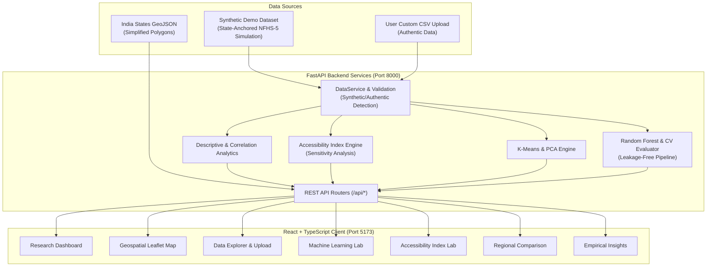

# MaternaAI – Maternal Healthcare Accessibility & Predictive Analytics
> **Tagline:** *Turning healthcare data into better maternal healthcare access.*

---

> [!WARNING]
> **Dataset Disclosure:** The bundled dataset (`datasets/demo/india_maternal_health_district_data.csv`) is a **Synthetic Demonstration Dataset** — a state-anchored NFHS-5 simulation generated programmatically. It does **not** contain actual district-level survey observations from NFHS-5, HMIS, or any other government source. All analytical results, ML metrics, and index scores computed from this dataset are **demonstration outputs only** and must not be interpreted as reflecting real maternal healthcare conditions across India. See [`docs/data_provenance.md`](docs/data_provenance.md) for full provenance documentation.

---

## 1. Project Overview & Vision
**MaternaAI** is a data science and machine learning research platform focused on analyzing maternal healthcare accessibility and regional healthcare disparities across India.

The platform ships with a **synthetic demonstration dataset** of 751 simulated district records across 36 States & Union Territories. District-level indicator values are generated via Gaussian noise around published **NFHS-5 (2019–2021)** state-level averages — they are not actual survey microdata. Users can upload authentic district-level CSV datasets through the Data Explorer for real analysis.

Through statistical modeling, unsupervised K-Means clustering, Random Forest regression, and geospatial choropleth mapping, MaternaAI enables researchers, demographers, and policymakers to discover where maternal healthcare services are insufficient and which structural factors correlate with service deficits.

### Core Research Question:
> *"Can machine learning and geospatial analytics identify regional disparities in maternal healthcare accessibility across India and help identify underserved regions?"*

> **IMPORTANT SCIENTIFIC DISCLAIMER:**
> This platform is an academic research and policy decision-support system, **NOT a clinical diagnosis application**. It does not predict individual pregnancy complications, prescribe treatments, or provide medical advice. All models are experimental and demographic in scope.

---

## 2. Key Features

- **Executive Research Dashboard:** Dynamic KPI tracking across districts and states/UTs, service continuum disparity charts, and indicator correlation matrices. Displays synthetic/authentic dataset status prominently.
- **India Healthcare Accessibility Map:** Interactive Leaflet choropleth visualization displaying state-level coverage with simplified boundary polygons.
- **Machine Learning Laboratory:**
  - *Unsupervised K-Means Clustering:* Evaluates cluster validity via Silhouette scores ($k \in [2, 7]$), standardizes features with `StandardScaler`, and visualizes high-dimensional partitions using 2D Principal Component Analysis (PCA).
  - *Supervised Regression (Random Forest & Linear Baseline):* Predicts regional coverage uptake (e.g., institutional delivery percentage) using socioeconomic determinants with 5-fold cross-validation, MAE, RMSE, and $R^2$ metrics. Train/test split is performed **before** imputation and scaling to prevent data leakage.
  - *Explainability:* Quantifies feature importances while clearly distinguishing correlation from clinical causation.
  - *Synthetic Data Labeling:* All ML metrics are tagged as "demonstration results" when computed from the synthetic dataset.
- **MaternaAI Experimental Accessibility Index:** Transparent, user-configurable multi-criteria weighted scoring model with directionality correction and sensitivity analysis (±20% weight perturbation). Classifies districts into *High Accessibility*, *Moderate Accessibility*, *Vulnerable*, and *Critical Priority*.
- **Data Explorer & Pipeline:** Ingests CSV files with validation (required columns, indicator checks, missing-value imputation tracking), profiles missing values and data types, searches and paginates through records, and exports cleaned CSV datasets.
- **Empirical Research Insights:** Automatically derives deterministic statistical observations with confidence levels conditional on dataset type.
- **Reproducible Research Notebooks:** 7 Jupyter research notebooks covering exploratory data analysis, cleaning, hypothesis testing, geospatial aggregation, clustering, modeling, and validation.

---

## 3. Technology Stack

### Frontend:
- **Framework:** React 18, TypeScript, Vite
- **Styling & Design System:** Tailwind CSS (custom scientific palette: Forest Green `#174C3C`, Sage `#A9C7B3`, Warm Ivory `#F8F7F2`, Coral `#E88D7D`, Lavender `#B8AED8`)
- **Typography:** Plus Jakarta Sans (headings), Inter (interface body)
- **Data Visualizations:** Recharts (Bar charts, Scatter plots, Pie charts, Heatmap breakdowns)
- **Geospatial Mapping:** Leaflet & React Leaflet with India State GeoJSON (simplified polygons)
- **Routing & Icons:** React Router DOM v6, Lucide React

### Backend:
- **Framework:** Python 3.14 / FastAPI, Uvicorn
- **Validation & Serialization:** Pydantic v2
- **Data Science & ML:** Pandas, NumPy, Scikit-learn, SciPy
- **Testing:** Pytest, HTTPX

---

## 4. System Architecture



---

## 5. Dataset Provenance & Data Dictionary

> **⚠ The bundled dataset is synthetic.** See [`docs/data_provenance.md`](docs/data_provenance.md) for complete generation methodology, audit results, and district-name coverage analysis.

### Bundled Synthetic Demonstration Dataset

| Property | Value |
|---|---|
| **File** | `datasets/demo/india_maternal_health_district_data.csv` |
| **Records** | 751 simulated district records |
| **States/UTs** | 36 |
| **Generation Method** | Gaussian noise around 36 state-level NFHS-5 baselines |
| **Named Districts** | 152 (real names); 599 generic placeholders (e.g., "Tamil Nadu District 16") |
| **Missing Values** | 0% (all values synthetically generated — unrealistic for real survey data) |
| **Source Label in CSV** | `data_source` column reads "NFHS-5 (2019-21) / MoHFW HMIS Benchmark Curation" — this is a **misleading artifact** of the generation script, documented in data_provenance.md |

### Indicator Definitions

| Indicator | Simulated Source Anchor | Description |
|---|---|---|
| `anc4_or_more_pct` | NFHS-5 state averages | % of mothers who received at least 4 antenatal checkups |
| `institutional_delivery_pct` | NFHS-5 state averages | % of births delivered in a healthcare facility |
| `skilled_birth_attendance_pct` | NFHS-5 state averages | % of births attended by skilled health personnel |
| `postnatal_care_pct` | NFHS-5 state averages | % of mothers receiving postnatal care within 48h of birth |
| `ifa_100_days_pct` | NFHS-5 state averages | % of mothers who consumed Iron Folic Acid for 100+ days |
| `first_trimester_anc_pct` | NFHS-5 state averages | % of pregnancies registered in the first trimester |
| `phc_chc_density_per_100k` | HMIS state estimates | Primary & Community Health Centres per 100,000 population |
| `female_literacy_rate_pct` | Census/NFHS-5 estimates | Female literacy percentage |
| `below_poverty_line_pct` | NITI Aayog MPI estimates | Multidimensional poverty headcount ratio |

### Uploading Authentic Data

Users can upload real district-level CSV data through the **Data Explorer** page. Uploaded files must include:
- **Required column:** `state_name`
- **At least one core indicator** from the list above
- Missing values are imputed using column medians with full tracking

---

## 6. Installation & Execution Guide

### Prerequisites:
- Python $\ge$ 3.10 (tested on Python 3.14)
- Node.js $\ge$ 18 (tested on Node v24)
- npm $\ge$ 9

### Step 1: Clone or Navigate to Project
```bash
cd D:\sem5\projects\MaternaAI
```

### Step 2: Backend Setup
```bash
# Install Python dependencies
pip install -r requirements.txt

# Run automated tests (11 tests)
pytest tests/backend -v

# Start the FastAPI backend server
python -m uvicorn app.main:app --app-dir backend --host 127.0.0.1 --port 8000 --reload
```
*Backend Swagger Docs will be accessible at: `http://127.0.0.1:8000/docs`*

### Step 3: Frontend Setup
```bash
cd frontend

# Install npm packages
npm install

# Start Vite development server
npm run dev
```
*Frontend interface will be live at: `http://localhost:5173`*

---

## 7. Machine Learning Methodology & Metrics

> **Note:** All metrics below were obtained from the **synthetic demonstration dataset**. Performance on authentic survey data may differ substantially due to the artificial inter-indicator correlation structure in the synthetic data.

1. **Unsupervised K-Means Clustering:**
   - **Preprocessing:** All indicators are scaled to zero mean and unit variance using `StandardScaler`.
   - **Evaluation:** Evaluated using Silhouette Coefficient ($S = \frac{b - a}{\max(a, b)}$) across $k \in [2, 7]$.
   - **Projection:** Visualized on the first two Principal Components.
   - **Profiles:** Districts are segmented into descriptive coverage groups.

2. **Supervised Random Forest Regressor:**
   - **Objective:** Predict institutional delivery rate based on ANC visits, literacy, poverty, and facility density.
   - **Pipeline Integrity:**
     - 80/20 train/test split performed **before** imputation and scaling (no data leakage).
     - `StandardScaler` fitted on training data only for fair Linear Regression comparison.
     - 5-Fold Cross-Validation on training set only.
   - **Demonstration Metrics (Synthetic Data):**
     - These metrics are inflated by the shared latent development factor in the synthetic data generation.
     - Actual performance on real district-level data would likely show lower R² and higher error.
   - **Feature Importance:** Quantifies relative predictive contribution — correlation ≠ causation.

---

## 8. Research Limitations and Ethical Considerations

1. **Synthetic Demonstration Data:** The bundled dataset is entirely generated programmatically. No district-level values are actual survey observations. Results are suitable for demonstrating the platform's methodology, not for policy conclusions.
2. **Non-Clinical Application:** The platform evaluates demographic coverage and structural disparities; it must never be used for individual clinical triage or obstetrical risk prediction.
3. **Survey Temporality:** NFHS-5 benchmarks reflect the 2019–2021 survey period. Ongoing improvements through national missions (e.g., PM Surakshit Matritva Abhiyan) may yield higher contemporary uptake.
4. **Statistical Association vs. Causation:** High regression weights for variables such as female literacy represent structural co-variation rather than immediate direct causation.
5. **Data Privacy:** All records handled in this platform are aggregated at the district or state level with zero personal health information (PHI) or identifiable individual survey microdata.
6. **GeoJSON Simplification:** State boundary polygons contain 7-9 vertices each (simplified approximations) — not official Survey of India boundaries. No district-level polygons are available.

---

## 9. References & Data Citations

> The references below describe the **government data sources** whose state-level published averages were used as anchors for the synthetic dataset generation. The bundled CSV does not contain data directly extracted from these sources.

- **IIPS & MoHFW (2021):** *National Family Health Survey (NFHS-5), 2019-21: India Fact Sheet*, International Institute for Population Sciences, Mumbai. — State-level averages used as generation baselines.
- **Ministry of Health and Family Welfare (MoHFW):** *Rural Health Statistics & HMIS Reports*, Government of India. — PHC/CHC density estimation reference.
- **World Health Organization (WHO):** *Standards for Improving Quality of Maternal and Newborn Care in Health Facilities*, Geneva. — Methodological framework reference.
- **NITI Aayog:** *National Multidimensional Poverty Index: A Progress Review 2023*, Government of India. — Poverty indicator baseline reference.

---

## 10. Documentation

| Document | Description |
|---|---|
| [`docs/data_provenance.md`](docs/data_provenance.md) | Complete dataset provenance: generation methodology, mathematical formulas, district-name audit, indicator attribution, and protocol for authentic data ingestion |
| [`README.md`](README.md) | This file — project overview, architecture, installation, and limitations |

---

## 11. License
Academic and Educational Research License &ndash; MIT License &copy; 2026 MaternaAI Contributors.
