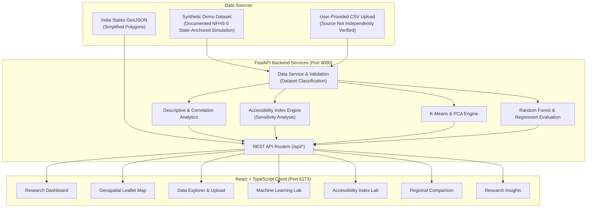

# MaternaAI – Maternal Healthcare Accessibility & Predictive Analytics

> **Tagline:** *Turning healthcare data into better maternal healthcare access.*

---

> [!WARNING]
> **Dataset Disclosure:** The bundled dataset (`datasets/demo/india_maternal_health_district_data.csv`) is a **Synthetic Demonstration Dataset**. It is documented as a state-anchored NFHS-5 simulation generated programmatically. It does **not** contain actual district-level survey observations from NFHS-5, HMIS, or any other government source.
>
> All analytical results, ML metrics, and accessibility scores computed using this dataset are demonstration outputs only. They must not be interpreted as representing actual maternal healthcare conditions across India.
>
> Refer to [`docs/data_provenance.md`](docs/data_provenance.md) for the documented generation methodology and dataset audit.

---

## 1. Project Overview & Vision

**MaternaAI** is a data science and machine learning research platform focused on analyzing maternal healthcare accessibility and regional healthcare disparities across India.

The platform includes a **synthetic demonstration dataset** containing 751 simulated district records across 36 States and Union Territories. According to the documented generation methodology, district-level indicator values are generated using Gaussian noise around published NFHS-5 (2019–2021) state-level averages. These values are simulated and are not actual district-level survey observations.

Users can also upload their own district-level CSV datasets through the Data Explorer. The platform validates uploaded files, but does not independently verify the authenticity or accuracy of their data sources.

Through statistical analysis, K-Means clustering, Random Forest regression, and geospatial visualization, MaternaAI provides tools to explore regional disparities and examine how socioeconomic and healthcare infrastructure indicators relate to maternal healthcare coverage.

### Core Research Question

> *"Can machine learning and geospatial analytics identify regional disparities in maternal healthcare accessibility across India and help identify underserved regions?"*

> **Scientific Disclaimer:**
> MaternaAI is an academic research and policy decision-support platform, **not a clinical diagnosis application**. It does not predict individual pregnancy complications, prescribe treatments, or provide medical advice. Its models are experimental and demographic in scope.

---

## 2. Key Features

- **Executive Research Dashboard:** Displays district and state-level KPIs, maternal healthcare service coverage, disparity charts, and indicator correlation matrices. Dataset status is prominently displayed.

- **India Healthcare Accessibility Map:** Interactive Leaflet choropleth visualization showing state-level healthcare coverage using simplified boundary polygons.

- **Machine Learning Laboratory:**
  - **Unsupervised K-Means Clustering:** Evaluates cluster quality using Silhouette scores across \(k \in [2, 7]\), standardizes features using `StandardScaler`, and visualizes clusters through two-dimensional Principal Component Analysis (PCA).
  - **Supervised Regression:** Uses Random Forest regression and a Linear Regression baseline to model institutional delivery percentage using socioeconomic and healthcare-related indicators.
  - **Model Evaluation:** Reports MAE, RMSE, R², and 5-fold cross-validation results.
  - **Feature Importance:** Examines the relative contribution of input features while distinguishing statistical association from causation.
  - **Synthetic Data Labeling:** Identifies model metrics as demonstration results when generated using the bundled synthetic dataset.

- **MaternaAI Experimental Accessibility Index:** A transparent, user-configurable weighted scoring model with directionality correction and sensitivity analysis using ±20% weight perturbations. Classifies districts into High Accessibility, Moderate Accessibility, Vulnerable, and Critical Priority categories.

- **Data Explorer & Pipeline:** Supports CSV uploads with column validation, missing-value profiling, median imputation tracking, record search, pagination, and cleaned CSV exports.

- **Research Insights:** Generates dataset-dependent statistical observations and highlights patterns in the available indicators. Insights derived from synthetic data are identified as demonstration outputs.

- **Reproducible Research Notebooks:** Seven Jupyter notebooks covering exploratory data analysis, data cleaning, statistical analysis, geospatial analysis, clustering, predictive modeling, and model evaluation.

---

## 3. Technology Stack

### Frontend

- **Framework:** React 18, TypeScript, Vite
- **Styling:** Tailwind CSS
- **Design Palette:** Forest Green `#174C3C`, Sage `#A9C7B3`, Warm Ivory `#F8F7F2`, Coral `#E88D7D`, Lavender `#B8AED8`
- **Typography:** Plus Jakarta Sans, Inter
- **Data Visualization:** Recharts
- **Geospatial Mapping:** Leaflet, React Leaflet, India State GeoJSON
- **Routing & Icons:** React Router DOM v6, Lucide React

### Backend

- **Framework:** Python 3.14, FastAPI, Uvicorn
- **Validation & Serialization:** Pydantic v2
- **Data Science & Machine Learning:** Pandas, NumPy, Scikit-learn, SciPy
- **Testing:** Pytest, HTTPX

---

## 4. System Architecture



---

## 5. Dataset Provenance & Data Dictionary

> **Important:** The bundled dataset is synthetic. Refer to [`docs/data_provenance.md`](docs/data_provenance.md) for the documented generation methodology, audit results, and district-name coverage analysis.

### Bundled Synthetic Demonstration Dataset

| Property | Value |
|---|---|
| **File** | `datasets/demo/india_maternal_health_district_data.csv` |
| **Records** | 751 simulated district records |
| **States/UTs** | 36 |
| **Generation Method** | Documented Gaussian-noise simulation around state-level NFHS-5 baselines |
| **Named Districts** | 152 real district names; 599 generic placeholders |
| **Missing Values** | 0% (all values synthetically generated) |
| **Data Type** | Synthetic demonstration data |

The district names are used for demonstration purposes and should not be interpreted as evidence that the corresponding indicator values are actual district-level observations.

### Indicator Definitions

| Indicator | Documented Reference Anchor | Description |
|---|---|---|
| `anc4_or_more_pct` | NFHS-5 state averages | Percentage of mothers who received at least four antenatal checkups |
| `institutional_delivery_pct` | NFHS-5 state averages | Percentage of births delivered in a healthcare facility |
| `skilled_birth_attendance_pct` | NFHS-5 state averages | Percentage of births attended by skilled health personnel |
| `postnatal_care_pct` | NFHS-5 state averages | Percentage of mothers receiving postnatal care within 48 hours of birth |
| `ifa_100_days_pct` | NFHS-5 state averages | Percentage of mothers who consumed Iron Folic Acid for 100 or more days |
| `first_trimester_anc_pct` | NFHS-5 state averages | Percentage of pregnancies registered in the first trimester |
| `phc_chc_density_per_100k` | HMIS reference estimates | Primary and Community Health Centres per 100,000 population |
| `female_literacy_rate_pct` | Census/NFHS-5 reference estimates | Female literacy percentage |
| `below_poverty_line_pct` | NITI Aayog MPI reference estimates | Multidimensional poverty headcount ratio |

These references describe the documented anchors for the synthetic generation process. They do not establish that the bundled district-level values were directly collected from those sources.

### Uploading User-Provided Data

Users can upload their own district-level CSV datasets through the **Data Explorer**.

Uploaded files must include:

- **Required column:** `state_name`
- **At least one core indicator** from the indicator list above.
- Missing values are handled through column-median imputation, with processing tracked by the platform.

**Data authenticity:** Uploaded files are treated as user-provided datasets. MaternaAI validates their structure but does not independently verify their sources, accuracy, or authenticity. Users should provide appropriate source documentation when using external datasets for research.

---

## 6. Installation & Execution Guide

### Prerequisites

- Python 3.10 or higher (tested with Python 3.14)
- Node.js 18 or higher (tested with Node.js v24)
- npm 9 or higher
- Git

### Step 1: Clone the Repository

```bash
git clone https://github.com/ritkritig/MaternaAI.git
cd MaternaAI
```

Replace `YOUR_USERNAME` with the GitHub username or organization that owns the repository.

### Step 2: Backend Setup

Open a terminal in the project root:

```bash
# Install Python dependencies
pip install -r requirements.txt

# Run automated backend tests
pytest tests/backend -v

# Start the FastAPI backend
python -m uvicorn app.main:app --app-dir backend --host 127.0.0.1 --port 8000 --reload
```

Backend API documentation:

`http://127.0.0.1:8000/docs`

### Step 3: Frontend Setup

Open a **separate terminal** in the project root:

```bash
# Navigate to frontend
cd frontend

# Install dependencies
npm install

# Start the Vite development server
npm run dev
```

Frontend interface:

`http://localhost:5173`

---

## 7. Machine Learning Methodology & Metrics

> **Note:** The bundled dataset is synthetic. All metrics generated using it are demonstration results. Performance on authentic district-level data may differ substantially because the simulated data contains artificial relationships between indicators.

### 1. Unsupervised K-Means Clustering

- **Preprocessing:** Indicators are standardized using `StandardScaler`.
- **Cluster Evaluation:** Silhouette Coefficient is evaluated across \(k \in [2, 7]\).
- **Projection:** Cluster results are visualized using the first two Principal Components.
- **Cluster Profiles:** District records are grouped into descriptive coverage categories.

The Silhouette Coefficient is calculated as:

\[
S = \frac{b-a}{\max(a,b)}
\]

where \(a\) is the average intra-cluster distance and \(b\) is the average distance to the nearest neighboring cluster.

### 2. Supervised Regression

- **Objective:** Model institutional delivery percentage using indicators such as antenatal care coverage, female literacy, poverty, and healthcare facility density.
- **Models:** Random Forest Regressor and Linear Regression baseline.
- **Data Split:** An 80/20 train/test split is performed before preprocessing.
- **Preprocessing:** Imputation and scaling are fitted using the training partition rather than the held-out test partition.
- **Evaluation:** Reports MAE, RMSE, R², and 5-fold cross-validation results on the training partition.
- **Feature Importance:** Examines relative predictive contributions. Feature importance does not establish causation.

**Evaluation limitation:** Preprocessing should be fitted separately within each cross-validation fold using a Scikit-learn Pipeline to avoid information leakage between training and validation folds. A separate held-out test set is used for final evaluation.

### Demonstration Metrics

- Metrics obtained from the bundled synthetic dataset should not be treated as evidence of real-world predictive performance.
- Artificial relationships introduced during synthetic data generation may inflate model performance.
- Evaluation on independently sourced district-level data is necessary before drawing conclusions about generalizability.

---

## 8. Research Limitations & Ethical Considerations

1. **Synthetic Demonstration Data:** The bundled dataset is generated programmatically. Its district-level values are not actual survey observations. Results demonstrate the platform's methodology and should not be used to make policy conclusions.

2. **Non-Clinical Application:** MaternaAI explores demographic coverage and structural healthcare disparities. It is not designed for individual clinical triage, pregnancy risk prediction, or medical decision-making.

3. **Survey Temporality:** NFHS-5 benchmarks correspond to the 2019–2021 survey period. They should not automatically be interpreted as representing current healthcare coverage.

4. **Association vs. Causation:** Statistical relationships between variables such as female literacy, poverty, and institutional delivery do not establish direct causal relationships.

5. **Data Privacy:** The bundled synthetic dataset contains no personal health information (PHI) or identifiable individual survey records. Users uploading external datasets are responsible for ensuring that they have the necessary permissions and that personal or sensitive information is appropriately anonymized.

6. **GeoJSON Simplification:** State boundary polygons are simplified approximations containing approximately 7–9 vertices each. They are not official Survey of India boundaries. District-level polygons are not available in the bundled map data.

---

## 9. References & Data Citations

The following publications and sources describe the government and institutional datasets referenced in the documented synthetic data generation methodology. The bundled CSV does not contain district-level observations directly extracted from these sources.

- **IIPS & MoHFW (2021):** *National Family Health Survey (NFHS-5), 2019–21: India Fact Sheet.* International Institute for Population Sciences, Mumbai. Referenced for state-level maternal healthcare indicators.

- **Ministry of Health and Family Welfare (MoHFW):** *Rural Health Statistics and HMIS Reports.* Government of India. Referenced for healthcare infrastructure indicators.

- **World Health Organization (WHO):** *Standards for Improving Quality of Maternal and Newborn Care in Health Facilities.* Referenced for the maternal and newborn healthcare framework.

- **NITI Aayog:** *National Multidimensional Poverty Index: A Progress Review 2023.* Government of India. Referenced for poverty-related indicators.

---

## 10. Documentation

| Document | Description |
|---|---|
| [`docs/data_provenance.md`](docs/data_provenance.md) | Dataset provenance, documented generation methodology, mathematical formulas, district-name audit, indicator attribution, and data ingestion protocol |
| [`README.md`](README.md) | Project overview, features, architecture, installation instructions, and research limitations |

---

## 11. License

This project is released under the **MIT License**.

Copyright © 2026 MaternaAI Contributors.
